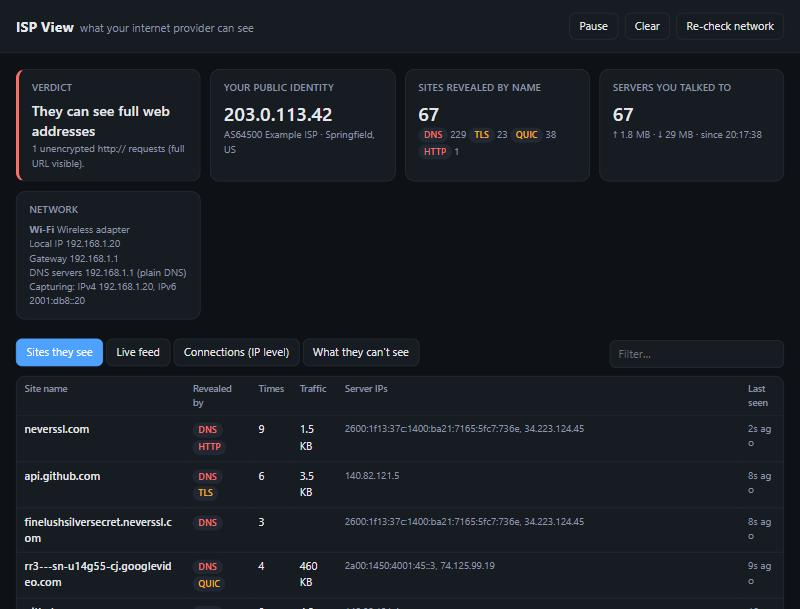
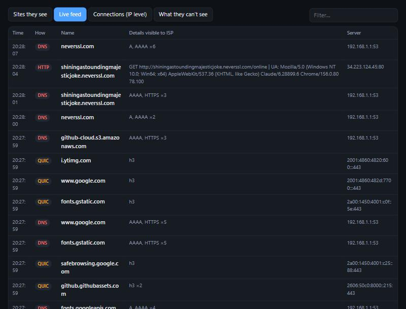

# ISP View

**See what your internet provider can see.** ISP View watches the traffic leaving your PC and shows, live, everything your ISP (or anyone else on the path) can read: the sites you look up, the sites you connect to, full addresses of unencrypted pages, which servers you talk to, and how much data goes each way.

[](../../releases/latest)
[](https://buymeacoffee.com/kuzucevirme)



## What it shows

| Label | What your ISP sees |
|-------|--------------------|
| **DNS** | Plain DNS lookups: the name of every site you look up |
| **HTTP** | Unencrypted `http://` requests: the full URL, your browser details, the page content |
| **TLS** | HTTPS connections: the site name (SNI), not the page or its content |
| **QUIC** | HTTP/3 connections: the site name, decrypted from the first packet just like an ISP can |
| **ECH** | Encrypted Client Hello: only a shared front name, the real site is hidden |
| **DoH / DoT** | Encrypted DNS is in use: lookups are hidden, the DNS provider is visible |
| **VPN** | VPN tunnel: only the VPN server and how much data you send |

The live feed shows every leak as it happens, including full `http://` addresses:



It also shows your public IP, provider and rough location, your DNS setup, and a per-server list of IPs, ports and traffic volume. A short verdict at the top sums it up, and the **What they can't see** tab explains how to hide more.

If a VPN is active, ISP View watches your physical network adapter, so you see what the ISP really gets: only the encrypted tunnel.

## Download and run

1. Download **ISPView.exe** from the [latest release](../../releases/latest).
2. Run it and accept the administrator prompt (Windows only lets admin programs read network traffic).
3. The dashboard opens in your browser at <http://127.0.0.1:8790/>. An eye icon appears in the system tray; right-click it for **Open**, **Pause capture**, **Clear data** and **Quit**.

Windows SmartScreen may warn about an unsigned app. Click **More info → Run anyway**, or run from source instead.

**Requirements:** Windows 10 or 11. No Npcap, WinPcap or other driver needed.

## Privacy

- Everything stays on your PC. Captured traffic is only kept in memory and is gone when you quit.
- The dashboard only listens on `127.0.0.1`, so other devices can't open it.
- At start, it asks one service ([ipinfo.io](https://ipinfo.io)) for your public IP and provider. You can turn that off with `public_ip_lookup` in `config.json`.
- ISP View only reads traffic. It never changes, blocks or sends anything on your behalf.

## Run from source

```
git clone <this repo>
cd isp-view
pip install -r requirements.txt
python ispview.py
```

Or double-click `Start ISP View.bat`. Python 3.10 or newer is required.

### Build the .exe yourself

```
pip install -r requirements.txt pyinstaller
python build.py
```

The result is `dist/ISPView.exe`. Pushing a tag like `v1.0.0` makes the included GitHub Actions workflow build the exe and attach it to a release.

## Settings (`config.json`)

Created with defaults on the first run, next to `ISPView.exe` or `ispview.py`. Delete it to reset everything. `config.example.json` shows the defaults.

| Key | Default | Meaning |
|-----|---------|---------|
| `host` | `127.0.0.1` | Address the dashboard listens on |
| `port` | `8790` | Dashboard port |
| `open_browser_on_start` | `true` | Open the dashboard when the program starts |
| `capture_interfaces` | `[]` | Adapter names (e.g. `"Wi-Fi"`) or IPs to watch; empty = the physical adapter with the default route |
| `capture_ipv6` | `true` | Also watch IPv6 traffic |
| `max_events` | `2000` | Entries kept in the live feed |
| `reverse_dns` | `true` | Look up the reverse DNS name of each server IP (what the IP alone tells your ISP) |
| `public_ip_lookup` | `true` | Look up your public IP, provider and location at start |
| `public_ip_url` | `https://ipinfo.io/json` | Service used for that lookup |
| `ui_refresh_seconds` | `2` | Dashboard refresh interval |
| `vpn_adapter_pattern` | *(regex)* | Adapter names/descriptions treated as VPN adapters |

## How it works

ISP View opens a Windows raw socket in "receive all" mode (`SIO_RCVALL`) on your network adapter and reads each packet's headers and the first bytes of each connection:

- **DNS**: parses queries and answers on port 53 (UDP and TCP).
- **TLS**: reassembles the TLS ClientHello (it can span several packets) and reads the SNI and ALPN.
- **QUIC**: derives the Initial keys from the connection ID that is sent in the clear (RFC 9001), decrypts the first packets and reads the ClientHello inside.
- **HTTP**: reads the request line, `Host` and `User-Agent` of plain HTTP requests.

On Windows, IPv6 raw captures arrive without the IPv6 header, so ISP View learns the remote address of outgoing IPv6 packets from the replies.

**Limits:** traffic from other devices on your network isn't shown (only this PC). On very fast downloads some packets may not be counted, so traffic totals can be a bit low.

## Support

If ISP View is useful to you, you can [buy me a coffee](https://buymeacoffee.com/kuzucevirme). ☕

## License

[MIT](LICENSE)
